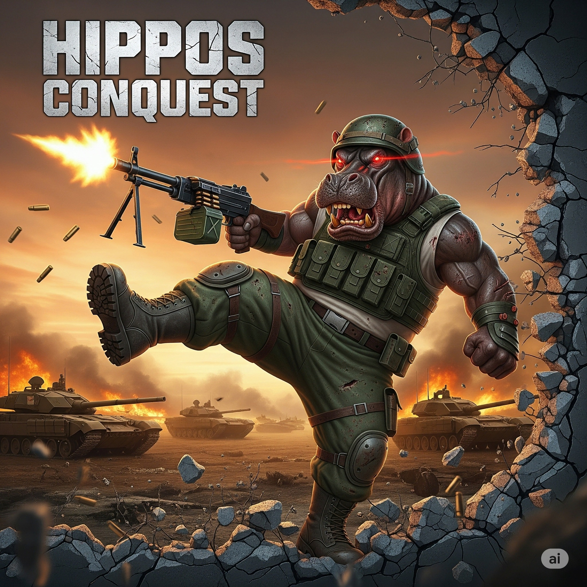

# Hippos Conquest



**Liberate Malden with autonomous armies, FOB attacks, flexible combat rules
and a searchable purchase catalog.**

Hippos Conquest is an Arma 3 co-op campaign by TheHungryHippo, built on
[Liberation RX](https://github.com/tbox1911/Liberation-RX). Capture territory,
build FOBs and recruit troops while AI armies fight the war around you. Play
with friends, or host alone and let the AI fill the battlefield.

- **Steam Workshop:** [Liberation Hippo - Malden](https://steamcommunity.com/sharedfiles/filedetails/?id=3827440475)
- **Discord:** https://discord.gg/HcXyqEaDVb (questions, settings help, suggestions)

## Play

1. Subscribe on the [Workshop](https://steamcommunity.com/sharedfiles/filedetails/?id=3827440475).
2. Launch Arma 3 and host a multiplayer game. LAN works for playing alone.
   Choose **Malden 2035**, then **Hippos Conquest**.
3. In the lobby, set **Parameters > Open Mission Parameters > Enabled**, start,
   adjust the settings, then press **Save and Continue**.
4. Build your first FOB and pick an objective. The war starts moving from there.

Vanilla factions work out of the box. Other faction presets need their mods;
[LRX Template](https://steamcommunity.com/sharedfiles/filedetails/?id=3014195090)
adds extended faction support. Everyone in the session needs the same mods.
Settings changes need a mission restart, and saved settings override defaults.
Admins can reopen the settings from the scroll menu, and wipe a campaign from
the lobby parameters.

## What Hippos Conquest adds

### A war that runs itself

- **AI Warfare** (on by default) fields ongoing forces from your chosen
  factions: a defending squad at every FOB, friendly assault squads, light and
  heavy vehicles, and enemy squads that attack your FOBs. Losses are replaced
  after a delay, so this is a continuing fight, not a single wave.
- AI vehicles prefer armed variants, and stuck or failed vehicles recover or
  get replaced.
- The commander, or a player vote, picks objectives. **Battle Scope** can pull
  nearby sectors into the same fight.
- **Command AI forces** (commander only, from the map or the action menu): pick
  any assault squad or armor group and send it to attack an active sector,
  defend a friendly sector or defend a FOB. Orders apply within seconds.
  The **AUTO** checkbox beside each group decides what happens once its target
  is taken: checked, it returns to automatic orders; unchecked, it stays and
  defends the captured sector (or holds its last objective). FOB guards always
  stay at their FOB.

### A living map

Built on the idea of crub's Team Map Intel:

- Every friendly AI group is on the map with a NATO symbol: AI Warfare squads
  and armor, FOB guards, base staff, mission units and garrisons. Lines show
  each squad's objective (yellow for commander orders).
- **Enemy intel**: enemy groups appear only while your side knows about them
  (what friendly AI on the server and headless clients, and your own group,
  have spotted). When contact is lost they become a **?** at the last known
  position for three minutes.
- **Shot markers**: every shot your side would know about sends a small
  rectangle flying from the shooter, blue for friendly and red for enemy fire,
  and the shooter's group icon flashes. That covers friendly fire anywhere and
  enemy fire within 1 km of any friendly player or AI (or from a spotted
  group), wherever you are on the map. A pulsing ring marks groups in combat.
- Hover a group to see its soldiers, vehicles and orders.
- A **Friendly Forces** panel counts squads, armor, guards, spotted enemy
  groups and active objectives, with FORCES, INTEL and SHOTS toggles.

### Sectors worth attacking

- Every active enemy sector gets a **command post**: a marked commander,
  guards, a patrol and static defenses (more at military sites), fitted to the
  ground around it.
- **Capture rules:** kill the commander and reduce the enemy infantry in the
  capture zone to 10% of its starting strength. You don't need to stand in the
  zone or destroy the radio tower.
- The HUD shows every active objective, its progress and its commander.
- Towns come alive with lightweight civilian crowds and traffic (cars,
  helicopters and planes), scaled by density and put to sleep far from players
  to save performance.

### Combat your way

These are defaults; most can be changed in the settings.

- **Easy AI** (on): friendly AI at maximum skill, enemies at minimum.
- **Enemy vehicle progression** (off): enemy armor isn't gated by readiness.
- **Second Chance** (off): no random temporary recovery.
- **Friendly-fire enforcement** and **Civilian casualty penalty** (off): no
  team-kill punishments or civilian penalties, and reputation can't drop.
- Thermals work day and night, and artillery has no firing limit.
- Every player is a Medic, Engineer, Explosive Specialist and UAV Hacker.
- No ejection from vehicle seats over ownership, rank or vehicle class. Locks
  and resource costs still apply.

### Squads, reviving and rewards

- Up to **150 units in your group** (instead of 50 for the whole side).
- Unlimited AI revives, a **Call Medic** action, and smarter medics that
  handle seats, orders and getting stuck.
- An orbiting camera while wounded, with lighter blood and screen effects.
- Kills by your squad, your vehicles and your purchased AI are credited to you,
  including vehicles that die later from their damage. Vehicle kills pay
  **ammo, XP and fuel** (half the ammo reward).

### Searchable purchase catalog

- The optional **All Factions Catalog** (off by default) lists troops and
  vehicles from every loaded mod: infantry, cars, trucks, armor, aircraft,
  boats, drones and statics.
- Search by name or class, filter by faction, type or **Unlocked only**, and
  browse collapsible groups with item counts.
- Locked entries stay visible, with tooltips that explain exactly what you're
  missing.

### FOBs, deployment and logistics

- More fortifications: sandbags, H-barriers, towers, raised HMG/GMG, static
  AA/AT, and Expeditionary Forces emplacements when that DLC is loaded.
- Temporary fortifications place instantly and expire after ten minutes.
- Deploy to your own parked vehicles, or back to where you last died while
  your grave remains.
- Repair, refuel and rearm cooldowns drop to about 20 to 30 seconds
  (configurable).
- More reliable garage, cargo, trader and warehouse handling.

### Presentation

- A proper loading screen with Hippos Conquest artwork, progress and status
  messages, and no lingering black screens on load or respawn.
- Hippos Conquest branding and music, larger dialogs, and clearer English
  settings and messages.

### Multiplayer performance

- Up to **three headless clients**. AI Warfare squads, sector defenders,
  patrols, static crews and civilian traffic are spread across them by load.
  If one disconnects, its AI moves to another headless client or the server.
- **Admin > AI load** shows FPS, groups and units for the server and each
  headless client.

## Inherited from Liberation RX

Everything else from Liberation RX is still here, including:

- Personal XP ranks, and a personal economy of ammo, fuel and manpower
- Owned and lockable vehicles, a virtual garage and a repaint menu
- Persistent saves for players, squads, vehicles and cargo
- LARs arsenal, R3F logistics (towing, sling loading, cargo), and ACE support
- AI revive, saved squad AI with ranks, and High Command squads
- Air support drops, artillery and an air taxi
- Side missions, secondary missions and intel
- A dog companion that finds enemies and marks IEDs
- Zeus for admins and commanders, and admin and moderator panels

See the [Liberation RX repository](https://github.com/tbox1911/Liberation-RX)
for the full feature list.

## Host a dedicated server

[tools/server](tools/server/README.md) has PowerShell scripts that start a LAN
dedicated server with up to three headless clients. You copy one config file,
set an admin password, and optionally point it at an Arma 3 Launcher mod preset.

## Build from source

Malden is the only map built and tested for Hippos Conquest. The other
`maps/` folders come from Liberation RX and haven't been updated.

Requirements: Python 3, Arma 3 and Arma 3 Tools. The build reads the upstream
Liberation RX history, so fetch it once:

```powershell
git fetch https://github.com/tbox1911/Liberation-RX.git master:refs/remotes/upstream/master --tags
python tools/build_malden.py --build-only --game-directory 'C:\path\to\Arma 3'
```

Leave out `--build-only` to also install the mission into your game's
`MPMissions` folder. The output goes to `mybuild/releases/`.

## Languages

New Hippos Conquest text is English only. Inherited Liberation RX text keeps
its French, German, Spanish, Russian and Simplified Chinese translations, so
other languages show a mix.

## Credits and license

Hippos Conquest is made and maintained by TheHungryHippo. It's based on
Liberation RX by pSiKO and contributors, and the original Liberation by Zbug
and contributors, with work from AgentRev, Larrow, GREUH and the authors of
the included addons. See [CREDITS.md](CREDITS.md).

Licensed under the [GNU GPL v3](COPYING.md).
